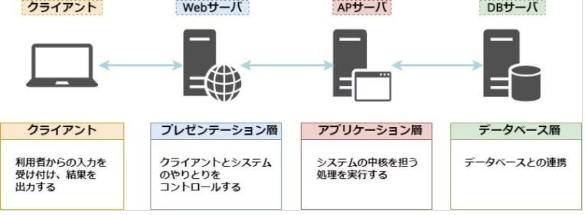

# 04 Flask 基礎

> バックエンド編 ／ 前の章：[03_function](../03_function/) ／ 次の章：[05_redirect](../05_redirect/)

Flask の基本を学ぶサンプル集です。Hello World から始まり、ルーティング・動的ルーティング・`render_template`・エラーハンドリングまでを順番に学べます。

> **02_memo_app_frontend とのつながり**：[02_memo_app_frontend](../02_memo_app_frontend/)で作ったメモアプリは、データがブラウザの`localStorage`の中だけにありました。ここからは、メモのデータをサーバー側で持つように作り替えていきます。この章ではその第一歩として、メモ帳の見た目（HTML・CSS）を、ファイルを直接開くのではなく**Flaskのサーバーから配信**します。JavaScriptの機能は、完成形の[100_memo_api](../100_memo_api/)で組み込み直しています。

各章は「機能の学習」と「`02_backend/00_my_app`を完成させるための機能追加」の2部構成です。前者は`example/`で単体のサンプルとして学び、後者は`challenge/`に取り組みます（メモ帳アプリを組み立てながら、`02_backend/00_my_app`に組み込むルーティングの練習です）。

## 目次

1. [Hello Sample — Flask 最小構成](#1-hello-sample--flask-最小構成) — Flask の最小構成を理解する
2. [Routing Sample — 基本ルーティング](#2-routing-sample--基本ルーティング) — 複数ルートを定義する
3. [Dynamic Routing Sample — 動的ルーティング](#3-dynamic-routing-sample--動的ルーティング) — URL パラメータで動的なルーティングを実装する
4. [render_template — テンプレートの描画](#4-render_template--テンプレートの描画) — 動的ルーティングで受け取った値をテンプレートに渡して描画する
5. [エラーハンドリング](#5-エラーハンドリング) — `abort()`と`@app.errorhandler()`でエラーレスポンスを制御する

---

## フォルダ構成

```
02_backend/04_flask_basic/
├── README.md
├── example/
│   ├── ex01_hello.py            # Flask 最小構成・Hello World
│   ├── ex02_routing.py          # 複数ルートの定義
│   ├── ex03_dynamic_routing.py  # URLパラメータ・コンバータ
│   ├── ex04_render_template.py  # render_template（変数を渡す/渡さない）
│   ├── ex05_error_handling.py   # エラーハンドリング（abort・@app.errorhandler）
│   └── templates/
│       ├── index.html           # ex04_render_template.py 用
│       └── detail.html          # ex04_render_template.py 用
└── challenge/                   # 練習問題（02_backend/00_my_appに組み込むルーティングの雛形）
    ├── challenge.py
    ├── static/                  # メモ帳の見た目（02_memo_app_frontend と同じ配色・レイアウトのCSS）
    │   └── style.css
    ├── templates/               # 完成済みテンプレート
    │   ├── top.html             # 静的なメモ一覧ページ（Flaskで配信する）
    │   └── detail.html          # 新規：メモ詳細ページ
    └── answer/                  # 練習問題の解答
        ├── challenge.py
        ├── static/
        └── templates/
            ├── top.html
            └── detail.html
```

---

## 1. Hello Sample — Flask 最小構成

> [example/ex01_hello.py](example/ex01_hello.py)

Flask アプリケーションの最小構成です。インスタンス生成・ルーティング・起動の3ステップを学びます。

### 用語：Web の基本的な仕組み

ブラウザが Web サーバにリクエストを送り、サーバがレスポンスを返すことで Web ページが表示されます。

```
ブラウザ  ──── リクエスト ────▶  Web サーバ（Flask）
         ◀──── レスポンス ────
```

| 用語 | 説明 |
|---|---|
| **HTTP** | Web 上でデータをやり取りするためのルール（プロトコル） |
| **リクエスト** | ブラウザなどのクライアントがサーバへ送るデータ |
| **レスポンス** | サーバがクライアントへ返すデータ（HTML・JSON など） |

リクエストとレスポンスの中身（ヘッダー・ボディ）や、URLの各部分の意味は、フロントエンド編の[01_frontend/01_web_basic](../../01_frontend/01_web_basic/)で扱いました。この章からは、レスポンスを**返す側**（サーバー）を作ります。

### 用語：サーバーの役割分担（Webサーバー・APサーバー・DBサーバー）

実際のWebサービスでは、「サーバー」の仕事を役割ごとに分けて、次のような**3層構造**で動かすのが一般的です。



| 種類 | 役割 | 例 | このカリキュラム |
|---|---|---|---|
| Webサーバー | リクエストを最初に受け取る。HTML・CSS・画像などの**静的なファイル**はそのまま返し、それ以外はAPサーバーに渡す | Nginx・Apache | 本番の公開で使う |
| APサーバー（アプリケーションサーバー） | プログラムを実行し、リクエストに応じてその場でページやデータを**作って**返す | Flask（＋Gunicorn）・Django・Node.js | この章から作る |
| DBサーバー（データベース） | データを保存し、APサーバーからの問い合わせに答える | SQLite・MySQL・PostgreSQL | `02_backend/10_sql`以降 |

```
ブラウザ ─リクエスト→ Webサーバー ─→ APサーバー ─問い合わせ→ DB
ブラウザ ←レスポンス─ Webサーバー ←─ APサーバー ←──結果──── DB
```

フロントエンド編のオリジナルHPのような**静的サイト**は、Webサーバーだけで公開できます。メモ帳アプリのように、人や条件によって内容が変わる**動的サイト**には、APサーバーとDBが必要です。開発中の`app.run()`では、Flaskの開発用サーバーが1つでWebサーバーとAPサーバーの両方の役割を果たしています（本番では役割を分けます）。

### 用語：URL の構造

`http://127.0.0.1:5001/list` を例に各部分の意味を示します。

```
http://  127.0.0.1  :5001  /list
──────   ─────────  ─────  ─────
スキーム  ホスト     ポート  パス
```

| 部分 | 説明 |
|---|---|
| **スキーム** | 通信方式（`http` / `https`） |
| **ホスト** | サーバの場所（`127.0.0.1` は自分のPC） |
| **ポート** | サーバの窓口番号（Flaskのデフォルトは`5000`。このカリキュラムでは、複数のアプリを同時に起動しても衝突しないよう、章ごとに`app.run(port=...)`で個別のポートを指定している） |
| **パス** | サーバ上のリソースの場所 |

`127.0.0.1`は**ループバックアドレス**と呼ばれる、「自分自身のパソコン」を指す特別なIPアドレスです。`localhost`という名前でも同じ場所を指します。開発用サーバーは自分のパソコンの中で動いているので、自分のブラウザからだけアクセスできます。

ポート番号は、1台のコンピュータの中で動いている複数のサービスを区別するための番号です。よく使うものは次のとおりです。

| ポート | 用途 |
|---|---|
| 80 / 443 | HTTP / HTTPS（URLで省略されているのはこの番号） |
| 5000 | Flaskの開発用サーバーのデフォルト |
| 8000 | `python -m http.server`のデフォルト（フロントエンド編で使用） |
| 22 | SSH（サーバーへのログイン） |

IPアドレス（プライベートIP・グローバルIP・確認コマンド）は[01_frontend/01_web_basic](../../01_frontend/01_web_basic/#9-ipアドレス)で扱っています。

```python
from flask import Flask

app = Flask(__name__)

@app.route("/")
def hello_world():
    return '<h1>Hello World!</h1>'

if __name__ == '__main__':
    app.run(debug=True, port=5001)
```

### ポイント

| 要素 | 説明 |
|---|---|
| `Flask(__name__)` | アプリインスタンスの生成 |
| `@app.route("/")` | URL とビュー関数の紐付け |
| `app.run(debug=True, port=5001)` | 開発サーバーの起動（`http://127.0.0.1:5001`） |

### 動作確認：サーバーが立ち上がり、レスポンスが返るか

```bash
python 02_backend/04_flask_basic/example/ex01_hello.py
```

| 確認する操作 | 確認したいこと |
|---|---|
| コマンドを実行する | ターミナルに`* Running on http://127.0.0.1:5001`のようなログが表示され、サーバーが待ち受け状態になる |
| ブラウザで`http://127.0.0.1:5001/`にアクセスする | 大きな文字で`Hello World!`と表示される |
| `app.py`の`'<h1>Hello World!</h1>'`を`'<h1>Hi!</h1>'`のように書き換えて保存する（`debug=True`のため） | ターミナルに再起動ログが表示され、ブラウザを再読み込みすると`Hi!`に変わっている（確認後は元に戻す） |

**正常な状態の見分け方**：ターミナルがエラーなく`Running on ...`のログを出し続けている状態が正常です。ポート`5001`がすでに使われている場合は`Address already in use`のようなエラーで起動が失敗するので、他の章のアプリを同時に起動していないか確認してください。

### app.run()の引数：debugとport

| 引数 | 説明 |
|---|---|
| `debug=True` | **デバッグモード**を有効にする。①コードを保存すると自動でサーバーが再起動する（`Ctrl+C`での再起動が不要）、②エラー発生時にブラウザ上に詳細なスタックトレースが表示される、という2つの恩恵がある。本番環境では**必ず`False`**にする（内部情報が漏れるため） |
| `port=5001` | 開発サーバーが待ち受けるポート番号を指定する。省略時はFlaskのデフォルトである`5000`が使われる。このカリキュラムでは、複数の章のアプリを同時に起動しても衝突しないよう、章・ファイルごとに異なるポート番号を割り当てている |

---

## 2. Routing Sample — 基本ルーティング

> [example/ex02_routing.py](example/ex02_routing.py)

複数の URL に対してそれぞれビュー関数を定義する方法を学びます。

### 用語：ルーティング・エンドポイント

| 用語 | 説明 |
|---|---|
| **ルーティング** | URL のパスとビュー関数を紐付ける仕組み。`@app.route("/list")` で `/list` へのアクセス時に対応する関数が呼ばれる |
| **エンドポイント** | アプリケーションがリクエストを受け付ける URL。Flask では `@app.route()` で定義したパスがエンドポイントになる |

```python
@app.route("/")
def index():
    return '<h1>Top Page</h1>'

@app.route("/list")
def item_list():
    return '<h1>Item List Page</h1>'

@app.route("/detail")
def item_detail():
    return '<h1>Item Detail Page</h1>'
```

### エンドポイント一覧

| URL | 関数名 | 説明 |
|---|---|---|
| `/` | `index` | トップページ |
| `/list` | `item_list` | アイテム一覧ページ |
| `/detail` | `item_detail` | アイテム詳細ページ |

### 動作確認：複数のルートがそれぞれ独立して動くか

```bash
python 02_backend/04_flask_basic/example/ex02_routing.py
```

| 確認する操作 | 確認したいこと |
|---|---|
| `http://127.0.0.1:5002/`にアクセスする | `Top Page`と表示される |
| `http://127.0.0.1:5002/list`にアクセスする | `Item List Page`と表示される |
| `http://127.0.0.1:5002/detail`にアクセスする | `Item Detail Page`と表示される |
| 定義していない`http://127.0.0.1:5002/other`にアクセスする | Flaskが自動生成する`404 Not Found`ページが表示される（`@app.route()`で定義していないパスは自動的に404になる） |

**正常な状態の見分け方**：3つのURLでそれぞれ異なる文言が表示され、定義していないURLだけ404になっていれば、ルーティングが意図通りに機能しています。

---

## 3. Dynamic Routing Sample — 動的ルーティング

> [example/ex03_dynamic_routing.py](example/ex03_dynamic_routing.py)

URL に変数を含める動的ルーティングを学びます。コンバータを使うことで受け取る値の型を指定できます。

### 用語：パスパラメータ・クエリパラメータ

URL でサーバにデータを渡す方法は大きく2種類あります。

```
http://127.0.0.1:5003/items/42?sort=asc
                              ──  ────────
                              ↑   クエリパラメータ（? 以降）
                              パスパラメータ（パスの一部）
```

| 種類 | 書き方 | 用途 | Flask での取得方法 |
|---|---|---|---|
| **パスパラメータ** | `/items/42` | リソースを特定する ID など | `<int:id>` でルートに埋め込み、引数で受け取る |
| **クエリパラメータ** | `/items?sort=asc` | 絞り込み・並び順など補助的な情報 | `request.args.get('sort')` |

パスパラメータはリソースの **識別** に、クエリパラメータはリソースの **絞り込みや並び替え** に使うのが一般的な設計です。

```python
# コンバータなし（str として受け取る）
@app.route('/dynamic/<value>')
def dynamic_default(value):
    return f'<h1>渡された値は[{value}]です</h1>'

# int コンバータ（整数として受け取る）
@app.route('/dynamic2/<int:number>')
def dynamic_converter(number):
    return f'<h1>渡された値は[{number}]です</h1>'

# 複数の値を受け取る
@app.route('/dynamic3/<value>/<int:number>')
def dynamic_converter_multiple(value, number):
    return f'<h1>渡された値は[{value}]と[{number}]です</h1>'
```

### コンバータ一覧

| コンバータ | 型 | 例 |
|---|---|---|
| （なし）| `str` | `/dynamic/hello` |
| `int:` | `int` | `/dynamic2/42` |
| `float:` | `float` | `/dynamic/<float:value>` |
| `path:` | `str`（`/` を含む） | `/dynamic/<path:value>` |

### クエリパラメータ — `request.args`

`?key=value` の形で URL に付加して渡します。`request.args.get('key', デフォルト値)` で取得します。

```python
from flask import Flask, request

# 単一のクエリパラメータ  例) /search?q=flask
@app.route('/search')
def search():
    keyword = request.args.get('q', '')
    return f'<h1>検索キーワード: [{keyword}]</h1>'

# 複数のクエリパラメータ  例) /items?sort=name&order=asc
@app.route('/items')
def items():
    sort  = request.args.get('sort', 'id')
    order = request.args.get('order', 'asc')
    return f'<h1>並び順: {sort} / {order}</h1>'

# パスパラメータ + クエリパラメータの組み合わせ
# 例) /categories/books?sort=price&order=desc
@app.route('/categories/<category>')
def category_items(category):
    sort  = request.args.get('sort', 'id')
    order = request.args.get('order', 'asc')
    return f'<h1>カテゴリ: {category} / 並び順: {sort} / {order}</h1>'
```

#### ポイント

| 書き方 | 説明 |
|---|---|
| `request.args.get('key')` | 値がなければ `None` を返す |
| `request.args.get('key', 'default')` | 値がなければ第2引数のデフォルト値を返す |
| 複数パラメータ | `&` でつなぐ（例: `?sort=name&order=asc`） |

### 実行方法

```bash
python 02_backend/04_flask_basic/example/ex03_dynamic_routing.py
```

### 動作確認：パスパラメータとクエリパラメータの違い

| 確認する操作 | 確認したいこと |
|---|---|
| `http://127.0.0.1:5003/dynamic/hello`にアクセスする | `渡された値は[hello]です`と表示される（コンバータなしは`str`として受け取る） |
| `http://127.0.0.1:5003/dynamic2/42`にアクセスする | `渡された値は[42]です`と表示される。ターミナルのログで`Type : <class 'int'>`になっていることも確認する（`int:`コンバータで型が変わる） |
| `http://127.0.0.1:5003/dynamic2/abc`のように**数値以外**でアクセスする | `404 Not Found`になる（`<int:number>`は数値以外のパスにマッチしないため） |
| `http://127.0.0.1:5003/dynamic3/foo/10`にアクセスする | `渡された値は[foo]と[10]です`と表示される（複数のパスパラメータを同時に受け取れる） |
| `http://127.0.0.1:5003/search?q=flask`にアクセスする | `検索キーワード: [flask]`と表示される |
| `http://127.0.0.1:5003/search`（`?q=...`を付けずに）アクセスする | `検索キーワード: []`と表示される（`request.args.get('q', '')`によりデフォルト値の空文字になる） |
| `http://127.0.0.1:5003/categories/books?sort=price&order=desc`にアクセスする | `カテゴリ: books / 並び順: price / desc`と表示される（パスパラメータとクエリパラメータが同時に使われている） |

**正常な状態の見分け方**：`/dynamic2/...`のようにコンバータで型を指定したルートは、指定した型に合わないパス（数値のところに文字列など）でアクセスすると404になります。素通りしてしまう場合はコンバータの指定を確認してください。

---

## 4. render_template — テンプレートの描画

> [example/ex04_render_template.py](example/ex04_render_template.py)

これまでは `return '<h1>...</h1>'` のように、HTMLを文字列として直接返してきました。`render_template()` を使うと、`templates/` フォルダの中に置いたHTMLファイルを描画して返せます。

```python
from flask import Flask, render_template

app = Flask(__name__)

# Top Page（変数を渡さないパターン）
@app.route('/')
def index():
    return render_template('index.html')

# Item Detail（動的ルーティングで受け取った値をテンプレートに渡すパターン）
@app.route('/items/<int:item_id>')
def item_detail(item_id):
    return render_template('detail.html', item_id=item_id)

if __name__ == '__main__':
    app.run(debug=True)
```

`templates/detail.html`（抜粋）：

```html
<p>URLの動的ルーティングで受け取った item_id は <strong>{{ item_id }}</strong> です。</p>
```

### ポイント

| 要素 | 説明 |
|---|---|
| `render_template('ファイル名')` | `templates/` フォルダ内のHTMLを描画してレスポンスとして返す |
| `render_template('ファイル名', 変数名=値)` | テンプレート側に変数を渡す |
| `{{ 変数名 }}` | テンプレート内でPython側から渡された値を表示する |

`{{ }}`は「渡された値をそのまま表示する」という最小限の使い方です。``・``のような条件分岐・繰り返しを含むJinja2の文法は`02_backend/06_jinja2`で詳しく学びます。

### なぜテンプレートに分けるのか

`3. Dynamic Routing Sample`のようにPythonの文字列（f-string）でHTMLを組み立てる方法は、HTMLが長く・複雑になるほど読みにくくなります。HTMLを`templates/`フォルダの`.html`ファイルに分離することで、Pythonのコード（ロジック）とHTML（見た目）を分けて管理できます。

### 実行方法

```bash
python 02_backend/04_flask_basic/example/ex04_render_template.py
```

ブラウザで`http://127.0.0.1:5004/`と`http://127.0.0.1:5004/items/42`を開いて確認してください。

### 動作確認：テンプレートに変数が渡っているか

| 確認する操作 | 確認したいこと |
|---|---|
| `http://127.0.0.1:5004/`にアクセスする | `templates/index.html`の内容が表示される（変数を渡していないページ） |
| `http://127.0.0.1:5004/items/42`にアクセスする | `templates/detail.html`が表示され、「URLの動的ルーティングで受け取った item_id は **42** です。」のように、URLの数値がそのままページ内に埋め込まれている |
| URLの`42`を`7`に変えて再アクセスする | 表示される数値も`7`に変わる（`render_template()`に渡した`item_id`の値がそのまま反映される） |

**正常な状態の見分け方**：URLのパスパラメータを変えるたびに、ページ内の表示もその値に追従して変わることが正しい状態です。値が変わらない・空欄になる場合は`render_template()`への変数の渡し忘れやテンプレート側の`{{ item_id }}`の書き間違いを疑ってください。

---

## 5. エラーハンドリング

> [example/ex05_error_handling.py](example/ex05_error_handling.py)

### 用語：HTTP ステータスコード

HTTPリクエストを受信したWebサーバからのレスポンスの状態を示します。ステータスコードは3桁の数字で表され、リクエストが成功したかどうか、エラーが発生したかどうかなどを示します。

| コード | 分類 | 説明 |
|---|---|---|
| 1xx | 情報 | リクエストを受け取り処理継続中 |
| 2xx | 成功 | リクエストを正常に処理 |
| 3xx | リダイレクト | 追加アクションが必要 |
| 4xx | クライアントエラー | クライアント側に問題あり |
| 5xx | サーバーエラー | サーバー側に問題あり |

よく見るステータスコード：

| コード | 意味 | 出てくる場面 |
|---|---|---|
| 200 OK | 成功 | ほとんどのレスポンス |
| 201 Created | 新規作成に成功 | JSON APIでデータを作成したとき |
| 204 No Content | 成功したが返す内容が無い | JSON APIでデータを削除したとき |
| 301 / 302 | リダイレクト（別のURLへ移動させる） | `02_backend/05_redirect` |
| 400 Bad Request | リクエストの形式や値が不正 | JSON APIに送った値が不正なとき |
| 401 Unauthorized | 認証（ログイン）が必要 | ログインしていない状態でJSON APIを呼び出したとき |
| 403 Forbidden | 権限が無い | この章のサンプル・他の人のデータを操作しようとしたとき |
| 404 Not Found | 見つからない | この章のサンプル・存在しないIDの指定 |
| 405 Method Not Allowed | そのURLでは使えないメソッド | `02_backend/08_request` |
| 500 Internal Server Error | サーバー内部でエラーが起きた | プログラムのバグ |

`abort()`で意図的にエラーを発生させ、`@app.errorhandler()`でエラーページをカスタマイズします。

```python
from flask import Flask, abort

app = Flask(__name__)

# 意図的に403エラーを発生させる
@app.route('/admin')
def admin():
    abort(403)

# 動的ルーティングと組み合わせる例：該当データが無ければ404
@app.route('/books/<int:book_id>')
def book_detail(book_id):
    title = books.get(book_id)

    if title is None:
        abort(404)

    return f'<h1>{title}</h1>'

# 404 エラーハンドラ
@app.errorhandler(404)
def not_found(e):
    return '<h1>404 - ページが見つかりません</h1>', 404

# 403 エラーハンドラ
@app.errorhandler(403)
def forbidden(e):
    return '<h1>403 - アクセス権限がありません</h1>', 403

# 500 エラーハンドラ
@app.errorhandler(500)
def internal_server_error(e):
    return '<h1>500 - サーバーエラーが発生しました</h1>', 500
```

### ポイント

| 関数・デコレータ | 説明 |
|---|---|
| `abort(ステータスコード)` | 処理を中断し指定のエラーを発生させる |
| `@app.errorhandler(コード)` | 特定のステータスコードに対するカスタム処理を登録 |

レスポンスの戻り値は`(HTMLテキスト, ステータスコード)`のタプルで返します。`3. Dynamic Routing Sample`や練習問題の`book_detail`では、該当データが無い場合をif文で手動処理していましたが、`abort(404)`を使うとその判定と404レスポンスの生成をFlaskに任せられます。

### 実行方法

```bash
python 02_backend/04_flask_basic/example/ex05_error_handling.py
```

ブラウザで`http://127.0.0.1:5005/admin`（403）や`http://127.0.0.1:5005/books/99`（404）を開いて確認してください。

### 動作確認：カスタムエラーページが標準のエラーページを置き換えているか

| 確認する操作 | 確認したいこと |
|---|---|
| `http://127.0.0.1:5005/`にアクセスする | `Top Page`と正常に表示される |
| `http://127.0.0.1:5005/admin`にアクセスする | `403 - アクセス権限がありません`と表示される（`abort(403)`が`@app.errorhandler(403)`に処理を渡している） |
| `http://127.0.0.1:5005/books/1`にアクセスする | `books`辞書に存在するID（1）なので`吾輩は猫である`と表示される |
| `http://127.0.0.1:5005/books/99`のように**存在しないID**でアクセスする | `404 - ページが見つかりません`と表示される（`title is None`のとき`abort(404)`が呼ばれる） |
| ブラウザの開発者ツールでネットワークタブを開き、上記403・404のレスポンスのステータスコードを確認する | それぞれ`403`・`404`になっている（`return '<h1>...</h1>', 403`のようにタプルの2番目でステータスコードを明示しているため） |

**正常な状態の見分け方**：エラー発生時に表示される文言が、Flask標準の素っ気ないエラーページではなく、`@app.errorhandler()`で定義したカスタムメッセージに置き換わっていれば正常です。標準のページのままの場合は`@app.errorhandler()`のデコレータの数値がずれていないか確認してください。

---

## 練習問題

> [challenge/challenge.py](challenge/challenge.py) — 問題
> [challenge/answer/challenge.py](challenge/answer/challenge.py) — 解答

### 問題：メモ帳の一覧ページをFlaskで配信し、メモ詳細ページを追加しよう

静的なメモ帳のトップページ（メモのカードがHTMLに直接書かれた、`02_memo_app_frontend`と同じ見た目のページ）を土台に、Flaskで配信できるようにし、さらにメモ詳細ページを追加します。`challenge/challenge.py`を開き、TODOコメントの指示に従って以下の仕様を満たすルーティングを実装してください。テンプレート（`challenge/templates/top.html`・`challenge/templates/detail.html`）とCSS（`challenge/static/`）は完成済みなので、Python側のルーティングだけを実装します。ここで作るルーティングは、この先の章で`02_backend/00_my_app`に組み込んでいきます。

```bash
python 02_backend/04_flask_basic/challenge/challenge.py
```

#### 仕様

| エンドポイント | メソッド | 処理 |
|---|---|---|
| `/` | GET | `top.html`を描画する（静的なメモ一覧ページ。変数は不要） |
| `/memos/<int:memo_id>` | GET | `detail.html`を描画する（動的ルーティングで受け取った`memo_id`から該当メモを探して表示する） |
| 上記で`memo_id`に該当するメモがある場合 | — | `title`・`category`・`body`を渡す |
| 上記で`memo_id`に該当するメモが無い場合 | — | `title`に`"メモID {memo_id} は見つかりません"`、`category`・`body`に空文字を渡す |

`top.html`のメモ一覧の各カードは、すでに`/memos/1`〜`/memos/5`へのリンクになっています。

#### ヒント

- `memos`は`{1: {"title": ..., "category": ..., "body": ...}, ...}`のような辞書。`memos.get(memo_id)`で該当データを取得する（無ければ`None`）
- 「見つかった場合／見つからなかった場合」の表示の出し分けは、テンプレート側の``ではなく、Python側の`if`文で`title`・`category`などの中身を作り分けることで実現する（``のようなJinja2の条件分岐は`02_backend/06_jinja2`で学ぶ）
- CSSは`static/`フォルダに置くと、Flaskが自動で`/static/ファイル名`というURLで配信してくれる（`url_for('static', filename=...)`という書き方は`02_backend/06_jinja2`で学ぶので、ここでは`/static/...`と直接書けばよい）

### 動作確認：TODO実装前後での挙動の違い

```bash
cd 02_backend/04_flask_basic/challenge
python challenge.py
```

| 確認する操作 | 確認したいこと |
|---|---|
| TODOを実装する**前**に`http://127.0.0.1:5006/`にアクセスする | ルートが未定義のため`404 Not Found`になる（まだ`@app.route('/')`を書いていないことの裏付け） |
| 問題1を実装後、`http://127.0.0.1:5006/`にアクセスする | メモ一覧ページ（`top.html`）がFlask経由で表示される |
| 問題2を実装後、一覧の中の1件（例：買い物リスト）のカードをクリックする | `/memos/1`に遷移し、タイトル「買い物リスト」・カテゴリ「家事」・本文がそれぞれ表示される |
| `http://127.0.0.1:5006/memos/999`のように存在しないIDに直接アクセスする | ページ自体は表示されるが（404にはならない）、タイトルが「メモID 999 は見つかりません」になり、カテゴリ・本文は空欄になる（`abort(404)`ではなく、仕様通りPython側で分岐した結果） |
| 迷ったら`answer/challenge.py`を`python answer/challenge.py`（ポート`5007`）で実行し、同じ操作をして見比べる | 挙動が一致している |

**正常な状態の見分け方**：存在するIDでは詳細が表示され、存在しないIDでは404にならずに「見つかりません」というメッセージ入りのページが表示される、という**Python側のif分岐による作り分け**ができていれば正解です。存在しないIDで404になってしまう場合は、`abort()`を使わず仕様通りに`title`等を作り分けられているか見直してください。

---

## 次のステップ

続きは [05_redirect](../05_redirect/) です。`redirect()`と`url_for()`で、別のURLへ移動させる方法を学びます。
